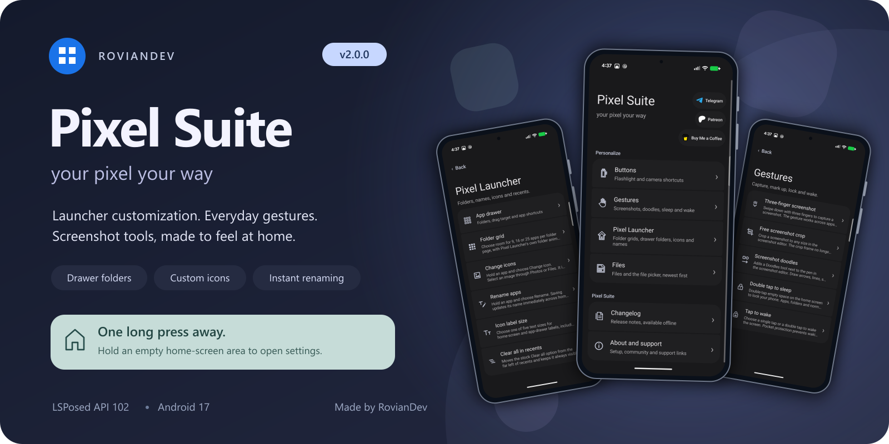

# Pixel Suite 3.0.0

Your Pixel. Your way.

Made by **RovianDev**. An open-source LSPosed module for Pixel phones: launcher customization and icon packs, navigation buttons, app and folder locks, gestures, screenshot tools, share menu tools, call recording, ad blocking and more. Every feature has its own switch.

**Open Pixel Suite from your home screen:** touch and hold an empty area, then choose **Pixel Suite settings**.

[📥 GitHub download](https://github.com/RovianDev/PixelSuite/releases/tag/v3.0.0) · [📥 Xposed download](https://github.com/Xposed-Modules-Repo/io.github.roviandev.pixelsuite/releases/tag/561-3.0.0) · [Full 3.0.0 release notes](RELEASE-NOTES-v3.0.0.md) · [Changelog](CHANGELOG.md)

## What's new in 3.0.0

The biggest Pixel Suite release yet:

- 📤 **Share menu tools:** reorder pinned apps and contacts, hide apps and contacts into folders.
- 🖼️ **Pixel Studio, reimagined:** pinch to zoom, an all-new text tool on the picture, the whole picture kept after a crop, a floating colour menu.
- 🎨 **Icon packs** for Pixel Launcher, cut into your icon shape.
- 📞 **Call recording** in the Google Phone app, in any country, without the announcement.
- 🚫 **Ad blocking** system-wide, in Chrome and Google News, plus an ad-free Google feed.
- 🔕 **Do Not Annoy:** silence incoming calls while staying connected.
- 🛡️ **OTA & Store blocker:** keep your system and chosen apps on their current versions.
- ⌚ **Pixel Watch eSIM** setup with a QR code, in any country.
- 🧭 **Navigation buttons** beside the gesture bar, with Circle to Search or Gemini on a long press of Home.
- 🍞 **Toasts:** show every toast at the top, in the middle or at the bottom.
- 💠 **A fresh look:** a redesigned app with search across every setting, and glass rims on Frosted Glass panels.
- 📱 **More Pixel Launchers supported**, and fixes for bugs in Google's own apps.

See the [full release notes](RELEASE-NOTES-v3.0.0.md) for every change.

## Features

**Pixel Launcher**
- Drawer folders with their own grids and sorting, adaptive 3×3 / 4×4 / 5×5 home folder grids, and single-app folders.
- Rename apps and change icons (your own pictures or any icon pack); changes show everywhere, including Google search.
- Icon packs, colorful drawer icons, five icon label sizes and Hide app shortcuts.
- Drag to home screen, two-finger drag and moving several apps at once.
- Always-visible Clear all, locked cards in recents and a cleaner landscape recents.
- Navigation buttons beside the gesture bar, and a choice of where toasts appear.

**Privacy & Security**
- Lock apps and folders with your fingerprint or PIN, with blurred previews in recents and protection against uninstalling, disabling or removing them.

**Buttons and gestures**
- Power button flashlight, volume-down camera, three-finger screenshot, double tap to sleep, and tap or double tap to wake 📲.

**Screenshots and photos**
- Pixel Studio: free crop, Doodles (shapes and arrows), zoom, an on-picture text tool and more.
- Google Photos: editable Doodles, working completely offline.

**Themes**
- Super Dark-Mode (pure black), three surface styles (Blur Off, Stock, Frosted Glass) with glass rims, and soft frosted edges.

**Google apps** (Patreon)
- Call recording, system-wide ad blocking (also in Chrome and Google News) and an ad-free Google feed.
- Pixel Watch eSIM setup with a QR code (one-time purchase).

**More**
- Share menu tools, Do Not Annoy, OTA & Store blocker, newest-first file sorting, refresh rate slider, Show FPS, secure-screen screenshots, hiding accessibility or Developer options from apps, and a keyboard bar tweak.

## 🔒 Privacy

Pixel Suite has no ads, analytics or tracking, and the module itself never connects to the internet. The app goes online only to check for updates (you can turn this off), to download the Ad blocker's lists while it's on, and for Patreon sign-in or the eSIM purchase if you use them. Doodles, screenshots, photos and call recordings stay on your phone.

## 📥 Install and scope

**Root + LSPosed API 102 required.** Tested on Pixel 11 Pro with Android 17.

1. Install **PixelSuite-v3.0.0.apk** over your current version.
2. Enable Pixel Suite in LSPosed and grant its app root access.
3. Open Pixel Suite and turn on the features you want. Each feature page has an **LSPosed scope** section listing the apps to select for it.
4. Select those apps in LSPosed, then reboot.

Set up a phone screen lock before using Privacy & Security. Save editor work before changing an editor feature. Call recording may be restricted by your country's laws; obtain any required consent before recording.

## 💬 Community and support

[Telegram](https://t.me/RovianDev) · [Become a patron](https://www.patreon.com/c/RovianDev) · [Coffee](https://buymeacoffee.com/roviandev) · [Bug reports](https://github.com/RovianDev/PixelSuite/issues)

## Source and credits

GPL-3.0. Build instructions are in **BUILD.md**; artwork and list credits are in **THIRD-PARTY-NOTICES.md**. Release signing keys and private signing files are not distributed. Pixel Suite is an independent project and is not affiliated with Google.
